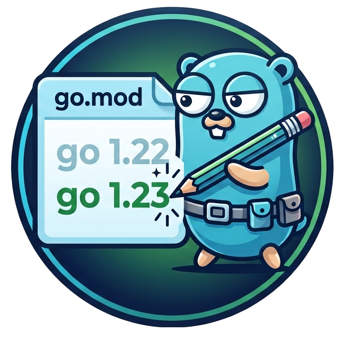

# gomod-go-version-updater-action

[](https://github.com/030/gomod-go-version-updater-action/releases)
[](LICENSE)

</a>

The rationale for this action is that
[Dependabot cannot](https://github.com/dependabot/dependabot-core/issues/9057)
update the go version that is defined in a `go.mod` file.

## Quickstart

1. To use this action, ensure that:
   `Allow GitHub Actions to create and approve pull requests` option has been
   enabled in the action settings. In order to find this, attach:
   `/settings/actions` to the project URL, i.e.:
   `https://github.com/<owner>/<project-name>/settings/actions`.
1. Once the setting has been enabled, create a
   `~/.github/workflows/gomod-go-version-updater.yml` file with the following
   content:
   ```yml
   ---
   name: gomod-go-version-updater-action
   "on":
     schedule:
       - cron: "42 6 * * *"
     workflow_dispatch:
   permissions:
     contents: write
     pull-requests: write
   jobs:
     gomod-go-version-updater-action:
       runs-on: ubuntu-22.04
       steps:
         - uses: 030/gomod-go-version-updater-action@v0.1.6
   ```

## Documentation

- [Configuration](docs/configuration.md): optional inputs and triggers.
- [Digest pinned Dockerfiles](docs/digest-pinned-dockerfiles.md): how a
  `FROM golang:<tag>@sha256:<digest>` line is bumped.
- [Development](docs/development.md): working on this action and running
  the tests.
